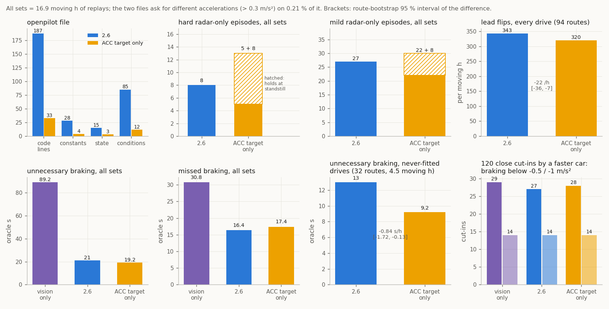

# 10. Research directions

The open questions of the project, each written as the question and the data that would answer it, ordered by how
directly the answer improves the radar in openpilot. [16: Routes and tests](16_routes_and_tests.md) turns them into
recording procedures, physical references and hand-in checklists; begin with the smallest observable contrast before a
long session.

Two install profiles frame the questions. `acc` (the default) publishes the radar's ACC target alone; `fused` publishes
every settled track with one Kalman speed filter per track. A question says which profile it concerns when it concerns
one. The status of the upstream candidates, the parts ledger and the evidence for the ACC target alone follow the
questions ([upstream interface](#towards-an-upstream-comma-interface), [parts](#parts-of-the-openpilot-file),
[ACC target alone](#the-acc-target-alone--candidate)).

## For a better ride

1. **The far range of every track.** *Where does the object list's short far reading come from, and what is the true
   distance?* The object list reads far cars 5-8% short of the radar's own ACC distance at 50-100 m, and the vision lead
   agrees with the ACC distance ([06](06_accuracy.md#distance)). `acc` publishes the ACC distance; `fused` takes it for the
   car the radar follows, publishes only that car beyond 60 m, and smooths the other tracks' object-list range separately
   from the speed filter (the object list's range rate and speed disagree by 10-20%,
   [12](12_kalman_filter.md#what-runs-before-and-around-the-filter)). *Data:* a drive behind a second car with a GNSS
   logger gives the true far distance ([T03/T04](16_routes_and_tests.md)).
2. **More of the lead covered by the radar's own trackers.** *When and why does the radar drop or delay its ACC target?*
   The target is present for 99% of radar-lead time at 15-80 m and 66% beyond 80 m on the owner's car
   ([08](08_openpilot_integration.md#on-the-road)). Beyond 60 m both profiles take only that target, and a fast far
   closing waits about 1 s for the radar to pick the car (0.8-1 s on the two cars measured,
   [`far_acc_only.json`](../data/analysis/summaries/far_acc_only.json)). *Data:* stock-ACC drives
   ([T08](16_routes_and_tests.md#t08-stock-acc-and-additional-target-reports)) with the target's acquisition and loss
   logged next to range, closing speed, curvature and camera state; every second of added coverage moves far leads from
   the camera to the radar.
3. **A controlled factory-camera comparison.** *What does the factory camera contribute to the ACC target's selection and
   kinematics?* The target's distance and speed hold steady where the camera's association (`112|3`) changes (steps at
   association onset: 0.06 m and −0.01 m/s), the camera's bus-1 frames arrive continuously (longest gap 0.78 s in 698
   one-minute segments), and the radar acquires far targets while the association field reads 0 (539 day acquisitions beyond 60 m, all
   with association 0; [05](05_acc_target_and_support.md),
   [`acc_target_camera.json`](../data/analysis/summaries/acc_target_camera.json)). *Data:* a paired parked or
   controlled-site intervention, clear against covered, on matched target paths
   ([T09](16_routes_and_tests.md#t09-factory-camera-dependence)); selection, kinematics and function restriction are
   compared separately, and the cover stays on only while parked.
4. **Physical units for the uncertainty fields.** *What error in m/s does one count of `240|7`, `232|7`, `224|7` and
   `248|7` stand for?* They are scaled against the radar's ACC target, the radar's own estimate
   ([03](03_slot_fields.md#uncertainty-and-quality)), and `fused` weights the object-list speed by 0.045 m/s per count of
   `240|7`. *Data:* an independent reference (a second car with a GPS logger, or a known far target; T05) gives them
   physical units and tests `fused`'s weights directly.
5. **Where the weighting lives.** *Can radard weight each radar reading by its reported variance as well as the interface
   does?* radard's per-track filter suits radars with a clean relative speed, and the ARS510's weighting lives in the
   interface. In replay (against `fused` 2.4, the version these radard variants ran against), a pass-through interface that
   hands radard each reading's variance, with radard also fusing the vision lead's speed, asks for 57 hard radar-only ticks
   on the held-out drives against `fused`'s 30; radard's vision fusion (`VISION_V_STD_SCALE` 2.0) on top of `fused` lowers
   unnecessary braking against the hindsight oracle (5.4 → 3.8 s on road drives) and raises missed braking (7.2 → 8.4 s;
   [`radard_side_options.json`](../data/analysis/summaries/radard_side_options.json)). *Data:* a radard filter designed
   for per-point variance, replayed on the same 27 drives and road drives against those numbers.
6. **Use the radar's own lead acceleration.** *How should the ACC target's relative acceleration (0x235 byte 2) reach the
   planner?* It tracks lead acceleration better than radard's derived `aLeadK` against a smoothed lead acceleration from
   the object-list speed (correlation 0.64 vs 0.56, RMS 0.69 vs 0.80 m/s², wobble 0.13 vs 0.15;
   [`acc_unit_recompute.json`](../data/analysis/summaries/acc_unit_recompute.json)). radard derives `aLeadK` from vRel for
   every car. Used as `aLeadK` for the ACC target's track (fork-side radard, replay on `fused` 2.4) it starts braking
   0.02 s earlier with 28 against 30 hard ticks, and a newly acquired target's acceleration starts near zero and replaces
   the deceleration radard has already built up, so more braking comes late on the road drives (missed braking
   7.2 → 10.8 s against the oracle, [`radard_side_options.json`](../data/analysis/summaries/radard_side_options.json)).
   *Data:* replays of a hand-over rule for newly acquired targets on those road drives.
7. **Lead acceleration in fork planners.** *Does a decaying extrapolation or an `aLeadTau` floor for radar leads remove the
   brake-then-accelerate swing?* StarPilot extrapolates `aLeadK` unchanged above 35 mph (read from its source, ○).
   *Data:* StarPilot replays with `tools/fork_lead` using each variant ([14](14_forks.md)).
8. **Road miles with `acc` and `fused`.** *Do the replay results hold in closed loop?* The replay results
   ([11](11_profiles_compared.md)) cover 16.9 moving hours on two cars; `fused` has closed-loop road drives
   ([08](08_openpilot_integration.md#on-the-road)), and closed-loop drives with `acc` are the next evidence. *Data:* drives
   with flagged moments, ideally from a second car, driver or radar firmware, with the installed profile recorded
   ([T13](16_routes_and_tests.md#t13-fresh-road-and-parser-validation)).

## Learn from Toyota's own longitudinal control

The owner's experience (○) is that Toyota's stock ACC on this car brakes and slows well for a lead in its own lane and holds on
to a lead that leaves for a turning lane. These are likely two different parts of its pipeline, and openpilot can learn
from the first:

- **Target choice.** The radar picks its ACC target ([05](05_acc_target_and_support.md)) and
  keeps a departing car until its centre is a median 1.64 m off-axis (middle half 0.67-2.16 m; 22 departures). Measured
  against the radar's own lane boundary from the 0x85 curve cells, the release comes when the car's centre is a median
  0.29 m inside that line (21 departures), which matches the rule "keep the target until its centre reaches my lane
  line" ([`acc_target_choice.json`](../data/analysis/summaries/acc_target_choice.json)). On two matched cut-ins on the
  fresh drives (n = 2, so the result is a hint), openpilot's model moved to the new lead first (1.5 s and ≥ 6 s
  earlier). `acc` hands the radar's choice to openpilot as one point and radard's camera match decides which lead the
  planner follows; `fused` publishes every track and leaves the choice to openpilot's model, which sees lanes.
- **The signal (Toyota's strength).** The radar's ACC speed is smooth and consistent with range during excursions,
  and 0x235 also carries a filtered relative acceleration. Both profiles use the speed (`acc` publishes it, `fused` takes it as a
  measurement).
- **The control law (◐, fitted on two cars).** While following, Toyota's 0x343 command is a linear law on its own ACC
  target: about 0.02 m/s² per metre of gap error, 0.25 m/s² per m/s of closing speed, and a time gap of about 1.1 s (1-bar
  setting, U1). The command trails the target through a short dead time (0.1 s), a slow first-order lag and a rate limit.
  A second car's stock drive fits once a **set-speed cap** is added: at or above the set speed Toyota holds about 0
  even with a large gap (u1 law R² −0.69 → 0.58 on the second car, U1 unchanged at 0.66). One law with that cap
  fits both cars (time gap 1.07 s). The law also explains Toyota's patience on far leads: a car closing at 3.5 m/s becomes
  the ACC target at 94 m, and Toyota holds +0.06 m/s² for 7 s. It first brakes at 66 m (about 15 s to contact) and
  reaches −0.83 m/s² at 52 m. The three recorded lead changes happened under gas override or at the set-speed cap; a lead
  change or cut-in under stock control with the driver off the gas is the data this study needs
  ([`stock_acc_law.json`](../data/analysis/summaries/stock_acc_law.json)).

Proposed study:

1. **Record stock ACC.** 20-30 minutes of mixed traffic with Toyota's ACC in control and the comma device logging
   (openpilot longitudinal off). The radar's own `ACC_CONTROL` (0x343) command then appears next to its target.
2. **Fit Toyota's law.** Model the requested acceleration from the radar's ACC target (distance, closing speed,
   relative acceleration), ego speed and the following-distance setting; compare it with openpilot's planner on the
   same moments (replayed with each radar profile).
3. **Separate signal from tuning.** Replay openpilot's planner fed with the radar's ACC values for the in-lane lead,
   and Toyota's fitted law fed with openpilot's lead. If the planner with Toyota's signal already behaves like Toyota,
   the remaining gap is radar handling (this repo); otherwise it is planner tuning, which belongs in the fork's
   longitudinal settings.
4. **Within-lane decisions.** Score both on in-lane braking events (onset, peak deceleration, jerk, gap at the end)
   and on lane-change / turn-lane departures, so a Toyota-like tune keeps openpilot's lead selection.

## For the drift discriminator

The goal: tell a velocity excursion from a real closing within about 1 s ([07](07_velocity_excursions.md)).

1. **A far-range truth drive.** *What is the lead's true velocity at 40-120 m?* A second car that logs its own speed (a
   second comma device, or a 5-10 Hz GNSS logger) gives it. The video-looming reference spans 10-130 m with 148 of its
   2,657 windows beyond 90 m, and shares the camera with the vision model
   ([`video_truth.json`](../data/analysis/summaries/video_truth.json)); a second car's own speed adds a reference
   independent of the camera.
2. **The first second of an excursion.** *Do velocity steps at onset share a size and sign?* Steps of a consistent size
   and sign indicate wrong-branch Doppler measurements leaking into the tracker; ordinary-sized steps indicate low-SNR
   tracking ([07](07_velocity_excursions.md#what-the-radars-waveform-allows)). *Data:* the 16.7 Hz records of the first
   second of logged excursions, binned by size and sign.
3. **Ego-speed waveform modes.** *Does the range noise floor step at the ego speeds where the handbook table's three
   bandwidths change?* Finding the steps, and the excursion rate in each mode, ties drift risk to a radar setting. *Data:*
   range noise and excursion rate in steady-speed stretches at several ego speeds.

## For the decode

- **Lateral frame and range zero from measured rotation.** *What are the lateral origin and scale, and the range zero?*
  Ordinary turns past parked cars give 69 codes per metre (65-74.5, [06](06_accuracy.md#lateral-position)). *Data:* slow
  turns around surveyed reflectors, with yaw and the radar-to-reference lever arm measured, separate scale from origin
  ([T07](16_routes_and_tests.md#t07-lateral-motion-heading-and-turning)); gyro closure is a consistency check, and the
  physical zero and a per-cent calibration take the surveyed reference.
- **`272|5` under a known overhead object.** *Which physical quantity is `272|5`?* Its ranking of pedestrians below cars
  points to a size- or reflectivity-like quantity. *Data:* passes under a bridge or gantry of known clearance and past
  parked vehicles of known height relate the code to height.
- **0x85 curve cells: units and the remaining fields.** *What are the units of heading and curvature, and the roles of the
  flag `79|1` and the structured fields `0|9`, `20|4`, `24|4`, `44|4` and `80|6`?* Heading `48|16` and curvature `64|15` are
  bounded to 1.6-2.2e-5 rad and 2.0-2.7e-6 1/m per code ([04](04_metadata_record_0x85.md#lane--road-boundary-curves)).
  *Data:* a camera lane polynomial with matched timing, or a drive along a surveyed curve of known radius.
- **Class 5.** *Is class 5 a cyclist?* *Data:* a few recorded passes of a cyclist and of a pedestrian test the bicycle
  reading of its size and speed.
- **0x195 `q10` with brake pressure.** *Which deceleration quantity does `q10` carry?* *Data:* the logged brake pressure or
  the brake-assist state next to the event code.
- **The radar's ACC tracker bytes and the night light records.** *What are the units of the two bytes of 0x237 that rise
  while the ACC target accelerates or brakes, and of the camera's 0x240 / 0x244 light-source records at night?*
  ([05](05_acc_target_and_support.md)). *Data:* a drive behind a car with known braking, and a night drive past lights at
  known positions.
- **What the camera association changes.** *What does `112|3` (association: inside 45 m by day, farther at night,
  [03](03_slot_fields.md#camera-association)) change in the radar's outputs?* *Data:*
  [T09](16_routes_and_tests.md#t09-factory-camera-dependence) compares matched target paths while parked; the
  observations fit every camera weight from 0 to 0.9 in exact mixture identities, so the total input weight needs the
  paired parked test
  ([`acc_camera_identifiability.json`](../data/analysis/summaries/acc_camera_identifiability.json)).

## For the integration

- **Other cars and firmware.** *Does the layout hold on other firmware?* openpilot's fingerprints list `8821F0R01100` for
  the RAV4 2022 platform, the only other `8821F0R` entry besides the documented `8821F0R03100`. *Data:* one capture from
  such a car confirms the layout and adds it to `ARS510_FW_VERSIONS` (until then the installer detects it by the bus-1
  fallback on a warm restart); a second unit also shows whether 0x500 / 0x502 differ per unit.
- **More closed-loop driving** with `acc` and `fused`, on a second car or with another driver
  (question 8 above).

## Keeping AEB under openpilot longitudinal

*Can a relay bring the radar's AEB back under openpilot longitudinal?* On an unfiltered radar line, openpilot longitudinal
disables the radar and its AEB. The disabled radar keeps assessing threats on bus 1, and openpilot would pass its brake
decision to the car as 0x283 / 0x344, keep 0x344 running for the brake system's link check, and show PCS on the dash only
while the relay is healthy. How it would work, and what is needed first, are in
[13](13_car_bus_messages.md#aeb-on-an-unfiltered-radar-line); the first item is one recorded stock AEB activation with bus 0 and
bus 1 logged ([15](15_pcs_testing.md)).

*What does the radar's PCS alarm react to, and from what size of object?* U3's alarm came with a parked pickup tracked at
14.5 m and an inflatable at the bumper that left the object list empty at its position
([13](13_car_bus_messages.md#a-recorded-stock-pcs-alarm-u3)). The radar tracks pedestrians at 0.5 × 0.4 m, so the
camera's link and a weak 77 GHz reflection are the two candidates. *Data:* a recorded series of alarms on radar-reflective
soft targets of graded size with separately characterised target controls ([15](15_pcs_testing.md)).

## What radard gets from other radars

What other radars in openpilot send (signals in their DBCs), the ARS510 counterpart, and the data that would close each gap
([`opendbc/car/*/radar_interface.py`](https://github.com/commaai/opendbc/tree/master/opendbc/car)):

| what other radars send | examples | ARS510 today | what would close the gap |
|---|---|---|---|
| per-track **measured vs predicted** state (`RadarPoint.measured`) | Toyota `VALID` + `SCORE`, Rivian `STATE`, Tesla `Meas` | `107\|1` = predicted (◐) and `16\|8` = existence probability (◐); the fork build publishes `measured = not predicted` for forks that carry the field; upstream openpilot has deprecated it | in place in the fork build; excursions arrive on measured records, so this is hygiene |
| **new-track** flag | Toyota `NEW_TRACK`, Rivian new states | derived from the age field (●) | in place |
| the radar's own **relative** speed | `REL_SPEED` on Toyota, Honda, Hyundai, Chrysler | over-ground speed (`64\|10`) minus 0xB4 ego speed | the ACC target carries a relative speed for the followed car |
| relative **acceleration** | Hyundai `REL_ACCEL`, Tesla `LongAccel` | `84\|10` over-ground acceleration (◐, lags about 0.5 s); the ACC target's relative acceleration (●) | calibrate `84\|10` against independent motion |
| **lateral speed** | Tesla `LatSpeed` | `74\|10` (◐, 0.147-0.155 m/s per code against the gyro, `decode_references.json`) | already published as `yvRel` where forks carry it |
| radar **fault / blockage** status | Honda `RADAR_STATE`, Tesla `sensorBlocked` | the interface reports `radarUnavailableTemporary` once the last record is older than 0.5 s; candidates (○): Toyota's car-bus 0x411 `PCS_HUD` alerts (`PCS_DUST2` sensor blocked, `PCS_INDICATOR` = 2 fault), the camera's object-list acknowledgement (0x101 byte 0, 0x197), and a long idle run of 0x680 while driving (longest 1.0 s in 7.8 h of normal driving) | parked baseline/covered/recovery diagnostic and passive captures ([T01](16_routes_and_tests.md#t01-parked-startup-and-status)); naturally occurring warnings from ordinary drives, kept in the logs |
| measurement **uncertainty** | (rarely exposed) | `224/232/240/248\|7` family, scaled against the radar's ACC target | physical units would let radard weight radar against vision |
| plain **DBC** decode through `CANParser` | every upstream interface | a 742-byte record split over 106 frames | a reassembler of about 80 lines (`ars510/transport.py`) and a CRC check |

The closest relative in openpilot is the Tesla Model 3's Continental radar (`tesla_radar_continental`, 66 code lines at the opendbc used for the replays):
- the radar sends distance, relative speed and acceleration, lateral position and speed, `Tracked`, `Meas`, existence
  and obstacle probabilities, class, size and uncertainty sigmas; the interface publishes `dRel` / `yRel` / `vRel` of
  tracked points plus the radar status as errors;
- the ARS510 slot follows the same Continental pattern, which is how its existence, predicted-record and uncertainty
  fields were identified ([03](03_slot_fields.md#uncertainty-and-quality));
- the two pieces a Tesla-sized interface would add: a **fault / blockage status**, and handling of the far-range speed
  error, which `fused` does by weighting each reading by `240|7` and the radar's ACC target
  ([12](12_kalman_filter.md#the-model)) and `acc` by publishing the ACC target alone.

## Towards an upstream (comma) interface

The integration installs on openpilot, sunnypilot, StarPilot and CarrotPilot as an appended hook. The proposal for
upstream is the ACC target alone (`acc`), written the way opendbc writes radar interfaces; the single-file `fused` is the
all-tracks candidate.

| | `acc`: the ACC target alone (proposal) | `fused`: every track (single file) |
|---|---|---|
| files | [`upstream/ars510_acc_target.py`](../upstream/ars510_acc_target.py) + [`toyota_tss2_ars510.dbc`](../upstream/toyota_tss2_ars510.dbc), as [`opendbc_ars510.patch`](../upstream/opendbc_ars510.patch) | [`upstream/ars510_radar.py`](../upstream/ars510_radar.py), routed by [`toyota_routing.patch`](../upstream/toyota_routing.patch) |
| size | 26 code lines (41 in the file), 7 DBC signals plus two rolling counters | 187 code lines (227 in the file) |
| constants / state attributes / conditions / functions | 1 / 1 / 4 / 2 | 28 / 15 / 85 / 13 |
| radar available when | known firmware, or 0x235 seen on bus 1 at fingerprinting | known firmware, or 0x80 seen on bus 1 at fingerprinting |
| evidence | [below](#the-acc-target-alone--candidate) | [parts ledger](#parts-of-the-openpilot-file) |

Sizes: [`acc_target_parser.json`](../data/analysis/summaries/acc_target_parser.json) (`file_size`) and
[`openpilot_file_parts.json`](../data/analysis/summaries/openpilot_file_parts.json).

The `acc` proposal, [`upstream/opendbc_ars510.patch`](../upstream/opendbc_ars510.patch), applies to opendbc master and adds:
- `opendbc/dbc/toyota_tss2_ars510.dbc`: the radar's two ACC target messages, 0x235 `ACC_TARGET_1` and 0x237
  `ACC_TARGET_2` (same file: [`upstream/toyota_tss2_ars510.dbc`](../upstream/toyota_tss2_ars510.dbc));
- `opendbc/car/toyota/ars510_acc_target.py`: a CANParser on those messages that publishes one point at 20 Hz and reports
  `canError` when they stop (26 code lines; same file: [`upstream/ars510_acc_target.py`](../upstream/ars510_acc_target.py));
- in `values.py` the radar DBC for the radar-ACC RAV4 2022 and 2023-25 platforms, and in `radar_interface.py` the
  dispatch to it;
- in `interface.py` detection: the radar counts as available when the known ARS510 firmware (`8821F0R03100`, for a
  cold start) or its ACC target (0x235) on bus 1 is present at fingerprinting. Other radar-ACC RAV4 radars, such as the 2022
  firmware `8821F0R01100` (its frames await a capture), stay radarless and report a clean CAN state. Selecting the parser by the car's radar DBC name follows smasher816's routing branch
  (PR #72);
- `opendbc/car/toyota/tests/test_ars510_acc_target.py`: recorded and packed frames, the idle (no-target) payload, a stuck
  counter, a silent radar, the 20 Hz cadence and the detection.

With the patch, opendbc's Toyota, platform-config, DBC-parser and car-interface tests pass and its ruff rules hold.
Through opendbc's own CANParser the DBC decodes the bundled frames exactly like the reference decoder
(`tests/test_acc_target_parser.py` checks the same in CI with a minimal parser). `install.py --profile acc` installs the
same file and DBC on a fork. Why the ACC target replaces the object list as the lead source: [the ACC target alone](#the-acc-target-alone--candidate).

If upstream wants every radar track instead, the candidate is the single file
[`upstream/ars510_radar.py`](../upstream/ars510_radar.py) (227 lines, 187 of them code). It holds the reassembler, the slot
decode, track IDs, the ACC target association, the Kalman speed filter and the path gate, in opendbc's style: it passes
opendbc's ruff rules (`upstream/ruff.toml`, checked in CI). It is the smallest version with the
same driving as the full filter: parts were removed alone and together on 27 replay drives, and every hard brake was
checked against the radar's raw range, the camera and the driver ([12](12_kalman_filter.md#removing-parts-together));
the wider ACC match and the path gate came from road drives ([12](12_kalman_filter.md#path-gate)). The ledger below
says what each line buys. A test keeps it equal to `fused` point for point (bundled samples; on 2.4.1 also two full road
drives, 200,209 points, identical; `upstream_equality_2_4_1` in
[`fused_filter.json`](../data/analysis/summaries/fused_filter.json)), and `install.py --profile openpilot` drives it on a fork.
What upstream review is likely to ask, from recent openpilot / opendbc radar PRs:

1. **For the single file: a clear reason the filter belongs in the interface.** Every upstream radar interface except Ford's passes the radar's
   tracks through. The ARS510's object list has slow, correlated speed errors whose width the radar's `240|7` code
   follows as a continuous scale (◐); the unfiltered decode asks for 93 hard radar-only ticks on the 20 held-out routes
   against 16 for `fused`
   ([`profiles_vs_vision.json`](../data/analysis/summaries/profiles_vs_vision.json)). The candidate's test covers the filter
   (unfiltered, the bundled excursion dives to −6 m/s). With the interface a pass-through and radard weighting each reading by a per-point
   variance, replay asks for hard radar-only braking about twice as often as `fused` (57 against 30 ticks on 2.4; [item 5 above](#for-a-better-ride)). Processing in the interface has precedent: openpilot's Ford
   interface (Delphi MRR, 272 lines, 184 of them code) clusters raw detections into tracks and associates them over time.
2. **Small, separable PRs.** Decode and points first (opendbc, decode only, tested on recorded frames), the
   filter second with before/after plots and process-replay diffs.
3. **Fleet evidence.** Replays come from two cars on one firmware (`8821F0R03100`): the owner's, and 8.8 h from a second
   car that was held out of all tuning ([12](12_kalman_filter.md#on-a-second-car)). Its radar unit has the same speed noise
   ([06](06_accuracy.md#velocity)). Drives on other cars and firmware, through `--profile openpilot`, are what upstream would weigh.
4. **Process replay coverage.** A route segment with the radar in openpilot's process-replay tests.
5. **Alpha longitudinal compatibility.** Covered for `8821F0R03100`: after openpilot's UDS radar-disable request the
   radar's car-bus messages stop while bus 1 keeps sending on an unfiltered radar line
   ([01](01_radar_bus.md#openpilots-radar-disable)).

### Parts of the openpilot file

Each part of [`upstream/ars510_radar.py`](../upstream/ars510_radar.py) (`fused`), its code lines (statements only, comments, docstrings and
blank lines left out of the count; shared constants counted once, counted as `tests/test_openpilot_file_ledger.py` does), what removing it costs
on the 27 replay drives, and its status for an upstream PR. The `acc` file has 26 code lines counted the same way.

| part | code lines | since | cost of removal | for upstream |
|---|---|---|---|---|
| transport, CRC, slot decode, track IDs, ego speed, RadarInterface wrapper | 103 | 1.0 | the car runs on vision only | required |
| ACC target decode and association | 27 | 2.0 (range scale 0.4 x since 2.3) | +24 unjustified hard ticks on 27 drives; with the 0.25 x scale, one road late brake -1.47 -> -2.36 m/s2 | keep |
| Kalman speed filter (one state, uncertainty-weighted) | 22 | 2.0 | hard radar-only ticks 48 with the filter alone against 93 for raw (20 held-out routes) | keep |
| young-track factor | 3 | 2.0 | further-drive hard ticks 2 -> 11; second car with the far rule (with the std gate): a -2.9 m/s2 brake on a young track | keep |
| speed-std publication gate | 2 | 2.0 | further-drive hard ticks 2 -> 8; second car: see the young-track factor | keep |
| age-60 publication gate | 2 | 1.0 | radar-only braking x3 (age 6); age 40: further-drive hard ticks 1 -> 9; age 80: more missed braking vs the oracle (3.3 -> 3.7 s on 2.3) | keep |
| range fusion (incl. ACC distance as the followed car's range) | 9 | 2.0 (ACC distance 2.1) | braking neutral; lead flips +39 %, target episodes 4 -> 6; second car with the far rule: braking neutral, flips +11 % | keep for lead stability; droppable at that cost |
| ego-speed alignment (0.149 m/s per code instead of the DBC 0.15) | 0 | 1.x | braking neutral (onset +12 ms); folded into the decode factor, so it costs 0 lines | keep (0 lines) |
| state pruning | 7 | 2.0 | state grows with every track id seen | required |
| path gate (yaw rate) | 6 | 2.3 (2.2 from 60 m) | back to 2.1 (removed with the 0.4 x match): held-out target episodes 3 -> 4, owner 0 -> 1, further hard ticks 1 -> 2; two road false brakes; second car with the far rule: braking neutral, flips +7 % | candidate: keep, or move into radard as a lateral gate |
| far cars: only the ACC target's track beyond 60 m | 2 | 2.6 | 2.5 over all four drive sets (16.9 moving h): oracle unnecessary braking 21.6 -> 28.5 s, lead flips 334 -> 418 /h, second car 0 -> 1 hard; with it a fast far closing waits ~1 s for the radar to make the car its ACC target | keep |
| stationary tracks path-gated close in too | 2 | 2.6 | all four drive sets: hard radar-only episodes 12 -> 8 (ticks 30 -> 16), mild 49 -> 26 with it; missed braking the same (parked cars at the curb while turning, a parked car alongside) | keep |
| fork compatibility (CP_SP argument, points assigned as a list) | 2 | 2.2 | crashes on sunnypilot | keep (harmless upstream) |

Numbers: [`openpilot_file_parts.json`](../data/analysis/summaries/openpilot_file_parts.json), with the evidence file for
each part.

### The ACC target alone (◐ candidate)

[`upstream/ars510_acc_target.py`](../upstream/ars510_acc_target.py) publishes only the radar's ACC target
(0x235 / 0x237: distance, lateral position, closing speed, target id) as openpilot's one radar point, the way Toyota's
own ACC uses the radar ([05](05_acc_target_and_support.md)). It is a CANParser on two messages, the target-present flags and
one point: 26 code lines (41 in the file) and a two-message, 7-signal DBC against 187 lines, 1 constant against 28, 4 conditions against 85.
The replay numbers below come from a hand-decoded version of 33 code lines that publishes the same points (all 11,028 bundled
reports identical); the DBC version reports `canError` instead of `radarUnavailableTemporary` when the frames stop
(13 gaps in 11.4 h of drives, all longer than 0.5 s, so both versions flag the same ones). The object list is the
tracker's raw state; the ACC target is its decision: one converged, in-path, moving target with a fine distance and a
filtered speed. Each part of `ars510_radar.py` above rebuilds a piece of that decision:
- the Kalman filter and the young-track factor rebuild the tracker's own speed filtering;
- the age and speed-std gates rebuild "converged";
- the path gates rebuild "in path";
- the far rule is the decision itself at range.

Tried and set aside: one gate-free Kalman model over every object (`shared_speed`, `shared_range`; over speed with a traffic
prior, or over range and range rate with the measured 3 % range noise) brakes hard while moving 59 and 168 times against
`fused`'s 8. Both object-list kinematic signals, speed and range, carry slow,
correlated errors that inverse-variance weighting leaves in place; the ACC target's speed follows the slope of its own
range (below), so the radar's decision carries consistent speed and range.

Replayed over every drive set (16.9 moving h, 62 routes, unchanged radard and planner):
- **Braking.** It asks for something different from 2.6 (> 0.3 m/s²) on 0.21 % of moving time. Every route-bootstrap
  difference to 2.6 includes zero: hard, mild, oracle unnecessary and missed braking.
- **Lead stability and onset.** Lead flips are lower (302 against 332 per hour). Braking starts 0.017 s before vision
  only on real closings (2.6: 0.010 s). The radar supplies the lead more often (88 % against 86 % of lead time),
  because the ACC target is published from the cycle it appears.
- **While moving,** it has 5 hard and 22 mild radar-only episodes against 8 and 27. Its other 8 count as hard because
  the car is stopped 0.7-4.8 m behind an object the camera leaves out of its lead list: radard's low-speed rule holds
  the car there, while vision only would ask to move off.
- **One far case:** a real object braking and drifting a lane over at 82 m, still flagged in-path by the radar. radard
  matches it to the camera's lead 27 m further on; this is the 7 hard ticks `acc` has while moving on the 4 further drives,
  where `fused` 2.6 asks −0.85 m/s² ([`profiles_vs_vision.json`](../data/analysis/summaries/profiles_vs_vision.json),
  [`acc_weight.json`](../data/analysis/summaries/acc_weight.json)).
- **On Toyota's stock-ACC drives** its requests track Toyota's command as closely as 2.6's: on U1 RMS 0.249 m/s² for
  both (jerk p99 0.167 against 0.176 m/s³); on the second car's stock drive (140 s) the two differ by 0.007 m/s² RMS,
  with correlation to Toyota 0.76 for both against 0.68 for vision only. The remaining gap to Toyota is common to both files.
- **Filter-free:** the ACC target's speed follows the slope of its own distance (best lag −0.06 s, gain 1.00), and its
  fast noise (0.027 m/s on the second car, 0.025 on the owner's;
  [`second_unit_noise.json`](../data/analysis/summaries/second_unit_noise.json)) is a fifth of its 0.125 m/s code step, so a filter would add delay.
- **On drives held out from development and tuning** (32 routes of both cars, 4.54 moving h) it brakes unnecessarily less
  than 2.6: 9.2 against 13.0 oracle seconds (−0.84 s per moving hour, route bootstrap −1.72…−0.13). Hard and mild
  radar-only braking are equal (1 against 0, a correct hold at 0.3 m/s 1.3 m from an object; 10 against 9), and braking
  starts earlier on real closings (−0.020 against −0.008 s vs vision).
- **Close cut-ins** (the lead jumps at least 5 m closer to within 35 m; 450 in all drives): the radar's ACC target moves
  to the cut-in car after a median 0.2 s (0.3 s for a faster car). On the 120 where that car is faster than ego, `acc` and 2.6 differ by at most 0.3 m/s² (braking below −0.5 m/s² in 28 against 27, below −1 in 14 against 14; vision only 29 / 14).
- **Over every drive** (94 routes, 21.45 moving h; it carries protocol values only, while 2.6 was tuned on most of them) it has
  fewer lead flips (−22 per moving hour, −36…−7). While moving it has 5 hard and 31 mild radar-only episodes against 8 and 36,
  28.4 against 35.0 s of unnecessary and 22.9 against 20.3 s of missed braking; the route-bootstrap intervals of those four
  differences include zero.
- **On 26 owner routes held out from every replay** (2.56 moving h):
  - unnecessary braking 7.7 against 2.6's 11.4 s, and lead flips 323 against 345 per hour (both route-bootstrap CIs
    exclude zero);
  - braking starts 0.053 s before vision only (2.6: 0.026 s);
  - hard, mild and missed braking tie within their intervals. Its one hard episode is a hold at 0.3 m/s, 1.3 m from an
    object, where the oracle asks for −2.65 m/s² too.

Each part earns its line, by what breaks when it is removed (replays of every drive set):
- **Target id as track id.** The id restarts radard's per-track filter at a target change; with a constant id the filter carries the old target's speed into the new
  one: unnecessary braking 19.2 → 37.2 s, hard episodes 13 → 16.
- **Lateral position.** At 0, radard's low-speed rule (points within 1 m of the path) takes targets that sit off the
  path: hard braking while moving 5 → 7, mild 22 → 27.
- **The radar's target-present flags.** They remove the point of an idle target; with the flags dropped it becomes a point at 0 m, which radard keeps
  switching to: lead flips 302 → 342 per hour, mild 30 → 32.
- **Reporting at 20 Hz.** Replay runs radard in simulation mode and shows the same results at 100 Hz; on the car radard
  accepts radarTracks at 8-24 Hz.

The hard, mild and onset numbers are independent of the oracle, whose reference lead takes its range mostly from the ACC
target and leans toward this file on unnecessary and missed seconds. Numbers:
[`acc_target_parser.json`](../data/analysis/summaries/acc_target_parser.json).
