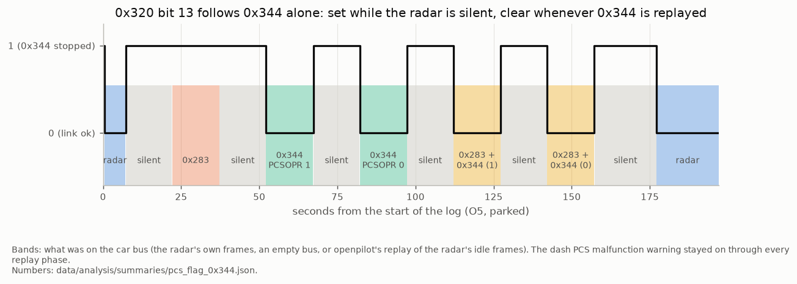

# 13. The radar's car-bus messages

On the RAV4 2022 / 2023 the ARS510 is also Toyota's driving-support ECU (`DS1` / "DSU" in the DBCs). It sends
nine messages on the **car bus (bus 0)**, the same ones a TSS-P DSU sends. They carry the ACC command, the
pre-collision (PCS / AEB) brake request and the PCS status on the dash. openpilot longitudinal either filters or switches off these
messages, which decides whether the car keeps its automatic emergency braking. The profiles (`acc`, `fused`, `raw`) read the
radar bus (bus 1) in every case; the car-bus messages below are independent of the profile. Numbers:
[`radar_car_bus_messages.json`](../data/analysis/summaries/radar_car_bus_messages.json) and
[`radar_disable_unfiltered.json`](../data/analysis/summaries/radar_disable_unfiltered.json).

## The nine messages

All nine stop when openpilot disables the radar ([01](01_radar_bus.md#openpilots-radar-disable)), so the radar sends them.

| addr | name (opendbc / Toyota) | rate, DLC | idle payload | content | |
|---|---|---|---|---|---|
| 0x343 | `ACC_CONTROL` / `ACC1S03` | 33 Hz, 8 | `00 00 43 00 00 00 00 91` at power-up | ACC acceleration request and ACC / HUD flags | ● |
| 0x344 | `PRE_COLLISION_2` / `ACC1F01` | 20 Hz, 8 | `00 00 01 00 00 00 00 50` | PCS / AEB deceleration request, pre-fill and alarm triggers; idle with only `PCSOPR` (bit 16) set; PCS alarm: `PCSALM` (bit 17) also set, `00 00 03 … 52` (U3) | ● idle and alarm, ◐ other fields |
| 0x283 | `PRE_COLLISION` / `DS11F01` | 33 Hz, 7 | `00 00 00 00 00 00 8C` | AEB brake force and state (`STATE` 3 = emergency braking); PCS alarm: byte 5 = 0x02 (bit 41, `PCSNOCHG`), force and state 0 (U3) | ● idle and alarm, ◐ braking fields |
| 0x33E | none | 5 Hz, 7 | `7F FF 00 80 00 xx 00` | target-gated fields, one rising with ego speed | ○ |
| 0x365 | `DSU_CRUISE` / `DS11D70` | 5 Hz, 7 | `00 00 00 00 FC 00 00` | **ACC lead distance (m) and relative speed (km/h)** | ● |
| 0x366 | `DS11D71` | 5 Hz, 7 | `50 00 7F FF 00 7A 00` | **target report**: the ACC target while one exists, plus other states: relative speed (0.5 km/h), distance (≈ 0.8 m), lateral offset (0.34 m per code) | ◐ |
| 0x411 | `PCS_HUD` / `DS12F02` | 1 Hz, 8 | `00 20 00 00 00 00 80 00` | PCS state, sensitivity, FCW and the blocked-radar / temperature / beam-alignment alerts; PCS alarm: `10 20 00 03 00 00 80 00` (FCW, byte 3 = 0x03; U3) | ● idle and FCW, ◐ alerts |
| 0x494 | none | 1 Hz, 8 | `82 00 00 00 00 00 00 00` | constant | ○ |
| 0x4FF | `FRD1N01` (front radar → gateway) | ~0.8 Hz, 8 | `3F 00 00 00 00 00 00 00` | front-radar node frame, `FRDNID` = 0x3F | ○ |

Toyota names come from the leaked `toyota_2017_ref_pt.dbc` in opendbc. 0x343, 0x344 and 0x283 end in the Toyota
checksum: (address high byte + low byte + DLC + data bytes) & 0xFF. In normal driving 0x283, 0x344, 0x411, 0x494 and 0x4FF hold their idle payloads
(4.1 h of owner drives and U1; 0x411 over 752 owner segments, where it reads `40 20 …`, `PCS_INDICATOR` 1, from about 0.2 s to 3 s
after each of 27 cold starts).
0x33E, 0x365 and 0x366 change with the lead.

### 0x365: lead distance and relative speed (●)

Byte 4 is the distance to the radar's ACC target in metres, and 0xFC means no target. Byte 5 is the relative speed in km/h,
signed, negative when closing. The other bytes are zero. Both fields match the ACC target (0x235 / 0x237,
[05](05_acc_target_and_support.md#the-radars-acc-target-0x235--0x237), 0.125 m/s and 0.025 m per code) on two owner drives and on a second car up to 37 m/s:

| drive | distance: scale, r, MAD | speed: scale, r, MAD | frames |
|---|---|---|---|
| O2 (city, ≤ 22 m/s) | 0.992, 0.9995, 0.24 m | 0.999, 0.9997, 0.14 km/h | 830 |
| O3 (city, ≤ 18 m/s) | 0.997, 0.9992, 0.17 m | 1.001, 0.9995, 0.14 km/h | 474 |
| U1 (expressway, ≤ 37 m/s) | 0.997, 0.9992, 0.22 m | 0.995, 0.993, 0.27 km/h | 1,816 |

This is opendbc's `DSU_CRUISE.LEAD_DISTANCE`, plus the Toyota name `D_VRCC` for byte 5.

### 0x366: target report, the ACC target and other states (◐)

Fields count MSB-first from the first payload bit; `ars510.support.parse_0x366` returns them (`None` for the `7FFF` no-target word).

| bits | field | coding |
|---|---|---|
| `16\|9` | relative speed | `(code − 155) × 0.5 km/h` for codes below 256; codes 442-506 (eight reports) fit `code − 512` and return `None` |
| `25\|7` | distance | ≈ 0.8 m per code (fit 0.79); 127 = no target |
| `40\|5` | lateral offset | signed, −0.34 m per code (right positive, ±5 m); 15 = no target, −16 = invalid (mostly a target beyond ±5 m) |

**While the radar has an ACC target, 0x366 reports that target.** Against the latest `0x235`/`0x237` on an owner drive
(820 frames) the residuals are 0.06 m/s, 0.26 m and 0.14 m, about the quantization of both frames, and 99 % agree in
distance within 1.5 m ([summary](../data/analysis/summaries/target_366_coding.json)).

**It also reports while there is no ACC target**: 224 of 1,059 reports on owner drive O2 and 8 of 467 on O3, with fresh
ACC frames saying "no target" (one span of 32 reports over 6.2 s). On O2 the car moves slowly during them (median ego 1.6 m/s, median relative speed −7 m/s); the 61 that match an
object-list track sit a median 4 m to the side, and their speeds correlate at 0.81; these reports are a candidate PCS target (○)
([coverage](../data/analysis/summaries/target_366_coverage.json)).

**High speed codes.** Eight reports have codes 442-506; five same-tail steps among them close at 20-28 m/s by their distances; subtracting 512 counts
fits them (mean difference 2.9 m/s). The parser returns a speed for codes below 256, the domain the ACC target confirms
([domain](../data/analysis/summaries/target_366_speed_domain.json)).

It arrives about 90 ms after 0x365. Byte 0 is 0x50 or 0x52, byte 4 bits 3-7 are raw speed / range-dependent flags, and
the low three bits of byte 5 are constant. The profiles read the same target from the 50 Hz ACC target frames.

### 0x343 from the radar (●)

With stock ACC (U1, 21 min) the radar's own command spans −0.52 to +0.20 m/s². It sends `ACC_TYPE` 1 and
`ALLOW_LONG_PRESS` 3 on every frame, `MINI_CAR` 1 while it has a lead (5,086 of 5,134 frames), `PERMIT_BRAKING` 1 on 4,971 frames, and `DISTANCE` pulses on button
presses. `RADAR_DIRTY`, `ACC_MALFUNCTION`, `ACC_CUT_IN` and `CANCEL_REQ` hold 0. openpilot's own `ACC_CONTROL` sends
`ALLOW_LONG_PRESS` 1.
On a second car with a board in the radar's car-bus line, stock ACC passes the radar's 0x343 through unchanged: `MINI_CAR`
equals ACC-target presence on 99.98 % of cruise-on cycles, and a closing car that becomes the ACC target at 94 m draws a command down to
−0.83 m/s² by 10 s later. Stopped behind a lead with cruise off, U1's command is −0.30 m/s² on 96 % of such cycles. How the command follows the ACC target is in
[10](10_research_directions.md#learn-from-toyotas-own-longitudinal-control)
([`stock_acc_law.json`](../data/analysis/summaries/stock_acc_law.json), [`radar_car_bus_messages.json`](../data/analysis/summaries/radar_car_bus_messages.json)).

## openpilot longitudinal: filter or disable

The radar's car-bus link runs to the gateway, which relays it onto the car bus. The comma harness sits at the camera,
so the radar's 0x343 reaches the powertrain on a path that bypasses the panda. With one 0x343 sender allowed on the
bus, openpilot longitudinal needs one of two setups:

| | radar CAN filter (smartDSU-style) | openpilot's radar disable (alpha long) |
|---|---|---|
| how | a board in the radar's line drops only the radar's 0x343 while openpilot sends its own; status message 0x2FF (~51 Hz) lets forks detect it | UDS `28 01 01` to 0x750 / 0x0F switches off the radar's car-bus transmit |
| radar's 0x343 | ends as openpilot's begins (3.487 s / 3.501 s after power-up, O4) | silent |
| PCS / AEB (0x283 / 0x344) | **passed to the car**: the radar's AEB stays in place | **silent**: the radar's PCS / AEB request is off with its car-bus output |
| 0x411 on the dash | the radar's: PCS on | openpilot's `40 20 00 00 10 01 00 00`: PCS off |
| car's reaction | normal (0x320 bit 13 clear) | **0x320 bit 13** set (0x344 missing, below); dash "Pre-Collision System Malfunction" and PCS OFF lamp |
| bus 1 (decoder input) | running | running ([01](01_radar_bus.md#openpilots-radar-disable)) |

**0x320 bit 13 = "0x344 missing" (●).** 0x320 (`VSC1S07`) is the gateway's brake-system status to the
driving-support ECU. Its bit 13 (byte 1 bit 5; Toyota name `P2BRXMK`) sets about 0.15 s after the radar's 0x344
(`ACC1F01`) stops and clears on the next 0x320 frame (20 Hz) once 0x344 is back. Only the presence of 0x344 moves it: 0x283
and 0x344's `PCSOPR` bit (16, "PCS operational", 1 in the radar's idle frame) leave it unchanged.

The test was run on O5, the owner's car, parked in P. Toyota's interface disabled the radar with openpilot's UDS request,
then replayed the radar's idle frames from openpilot in 15 s phases:

| on the car bus (O5) | 0x320 frames with bit 13 clear / set |
|---|---|
| radar's own messages | 2,713 / 1 |
| radar silent, nothing replayed | 0 / 1,906 |
| idle 0x283 only | 0 / 307 |
| idle 0x344 (`PCSOPR` 1) | 306 / 0 |
| idle 0x344 with `PCSOPR` 0 | 305 / 1 |
| 0x283 + 0x344, `PCSOPR` 1 / 0 | 305 / 1, 305 / 1 |

The single set frames are each the last frame of a phase, 0.15 s after 0x344 stopped. On U2 (unfiltered, alpha long)
the bit sets 0.17 s after the radar's last car-bus frame and stays set for the whole drive; on U1 and on filtered cars it is clear.

**The dash warning follows the radar's messages (●, O5); 0x411 is the leading candidate for its input (◐).** From about 7 s
after the radar fell silent, the dash showed "Pre-Collision System Malfunction – Visit Your Dealer" with the PCS OFF lamp.
It stayed on in every replay phase (bit 13 clear or set) and cleared by itself, with no restart, once the radar's messages
(including its 0x411) were back. Replaying idle 0x344 therefore satisfies the brake system's link check (bit 13 clear)
while the dash keeps showing that PCS is off, and the radar's PCS brake request stays off.

**The event pair keeps running while the radar is disabled (◐).** On U2 the bus-1 event pair 0x195 / 0x196
([05](05_acc_target_and_support.md#0x195--0x196-event-pair)) became active 6 times (0.1-1.3 s, 4-7 m/s, ACC-target
time to collision 3.6-7.5 s); the state lives on bus 1. On U1 (stock ACC) the 5 comparable short states
left 0x283 / 0x344 / 0x411 idle: the event pair is a threat state that occurs without PCS action on the car bus (◐); the PCS brake request
itself travels on the car bus.

## What panda allows openpilot to send

openpilot's Toyota longitudinal TX list (DSU-unplugged TSS-P support) already covers most of these messages:

| message | panda |
|---|---|
| 0x343 | allowed, `ACCEL_CMD` −3.5..+2.0 m/s² |
| 0x344, 0x33E, 0x365, 0x366, 0x411 | allowed |
| 0x283 | allowed only with bytes 0-5 zero (the idle frame) |
| 0x494, 0x4FF | outside the TX list |

opendbc's `toyotacan.create_pcs_commands` builds 0x283 + 0x344 (the carcontroller leaves it uncalled).

## AEB without a CAN filter

**Today:** stock AEB runs with stock ACC (openpilot lateral only, no filter) and with openpilot longitudinal through a
radar CAN filter. With openpilot longitudinal and no filter, the radar is disabled and the car's PCS brake request is off; the dash
shows "Pre-Collision System Malfunction" and the PCS OFF lamp.

**Why the disable takes AEB with it.** AEB is a live request: the radar sends non-idle 0x283 / 0x344 frames at the
moment it decides to brake, and the brake system acts on them. UDS communication control (`28 01 01`) stops all of the
radar's normal car-bus messages at once, 0x283 / 0x344 included: after the radar's response on U2 (12.48 s) no 0x283 / 0x344
frame follows in 26 min ([`radar_car_bus_messages.json`](../data/analysis/summaries/radar_car_bus_messages.json)).

### A recorded stock PCS alarm (U3)

U3 is a deliberate test on the second car (stock ACC, radar enabled, no filter), approached at 7 m/s: an inflatable
decoration stood in the lane, with a pickup parked a few metres behind it. **The radar tracked the pickup.** Its only
object and its ACC target (one ID throughout) read 8 m at the stop, while the inflatable was at the bumper, and the
inflatable produced no entry in the object list. The radar's **PCS alarm stage** ran from 56.151 to 56.922 s. The driver
braked 0.12 s later and stopped with the inflatable at the bumper; the braking stages (0x283 `FORCE` / `STATE`, 0x344
`DSS1GDRV`) stayed at 0 ([`pcs_activation_u3.json`](../data/analysis/summaries/pcs_activation_u3.json)).

**The alarm was most likely for the pickup (◐).** At the alarm the pickup was at 14.5 m, a time to collision of 2.1 s.
- **The in-path object is a vehicle.** The pickup was the only tracked object (object-list object 2, in path,
  stationary, first seen at 29.1 m) and the ACC target; the object list held nothing at the inflatable's position.
- **The camera's logged frames held constant.** On bus 1 the camera's frames (0x101 / 0x102, 0x180, 0x197, 0x210, 0x24D,
  0x500 / 0x501) stayed constant, and 0x240-0x248 only stepped their phase counter with default daytime bodies. On the
  car side only steering messages moved: 0x191, 0x2E4 and 0x371 `LTA_RELATED`.
- **The target of the alarm is a research question** ([10](10_research_directions.md), [15](15_pcs_testing.md)): the camera
  also reaches the radar over a link the logs do not carry ([03](03_slot_fields.md#camera-association)), and the object list
  shows the radar's filtered tracks, so a camera trigger on the inflatable and a weak radar detection of it remain candidates.
- The 0x100 flag marks the alarm in every reading.

**What triggers the radar's PCS on an object like the inflatable?** Object size admits it: the radar tracks pedestrians
at 0.5 × 0.4 m, and its ACC target has followed stationary objects as narrow as 23 cm while driving
([05](05_acc_target_and_support.md#class-width-and-timestamp-0x239--0x23b)). U3's inflatable produced no object-list
entry, which points to its weak reflection at 77 GHz (○). A minimum size for the PCS is one question for a recorded
series of events.

| t (s) | radar bus (bus 1) | car bus (bus 0) |
|---|---|---|
| 55.09 | event pair 0x195 / 0x196 leaves idle | |
| 55.6 | ACC target appears: the parked pickup, 18.9 m, closing at 7.0 m/s | |
| **56.1506** | **0x100 byte 0 → 0x02** | **same CAN tick:** 0x283 → `… 02 8E`, 0x411 → FCW; 0x344 → `PCSALM` at its next slot (56.180) |
| 56.27 | | driver brake |
| 56.913-56.922 | 0x100 → 0 | 0x411, 0x283, 0x344 back to idle |
| 57.18 | event pair back to idle | |

**0x100 byte 0 = 0x02 is the radar's PCS alarm flag on bus 1 (◐, one event).** It starts and ends with the car-bus
alarm, and in every stored log (1,597 rlogs, 936,440 0x100 frames, three cars) it occurs in exactly these 9 frames. The
other non-zero 0x100 is the `FF FF` first frame after power-up. The event pair fires in many drives without any PCS
output: it is the radar's threat state, and 0x100 marks the decision to warn. Numbers:
[`pcs_activation_u3.json`](../data/analysis/summaries/pcs_activation_u3.json).

### Relaying the radar's decision (○ theoretical)

The disable silences the radar's car-bus side. On bus 1, which the comma reads, the radar keeps sending its object
list, ACC target and threat states at full rate ([01](01_radar_bus.md#openpilots-radar-disable)). On U2 its short
time-to-collision event pair (0x195 / 0x196, [05](05_acc_target_and_support.md#0x195--0x196-event-pair)) kept firing
while it was disabled. The radar's PCS logic appears to keep running with only its output to the car cut. A relay would
reconnect that output through openpilot, so Toyota's own tuned decision logic still decides when to brake.

How it would work:

1. **Listen on bus 1.** Each cycle openpilot reads the radar's PCS state from bus 1: alarm, pre-fill, brake assist,
   autonomous braking, and the requested deceleration. The alarm stage is there: 0x100 byte 0 = 0x02 matches the
   car-bus alarm to the CAN tick (U3, above). Pre-fill and braking need an activation that reaches them; the event pair
   is a threat state.
2. **Translate to the car bus.** openpilot sends the 0x283 / 0x344 / 0x411 frames the radar would have sent for that
   state. The mapping is learned from a car with a radar CAN filter, where both buses are visible at once during a stock
   activation: each bus-1 state lines up with the car-bus frames the radar sent at the same moment.
3. **Keep the streams running.**
   - **0x344 without a gap** (20 Hz, idle `00 00 01 00 00 00 00 50`). The brake system checks for it: 0x320 bit 13
     sets 0.15 s after it stops (above).
   - **0x283 idle** (33 Hz), so an activation only changes the content of a running stream.
   - The stages carry the reference names: alarm (`PCSALM`, `PCSWAR`, FCW in 0x411), brake pre-fill (`PREFILL`),
     brake assist, autonomous braking (0x283 `FORCE` and `STATE` 3, `PRECOLLISION_ACTIVE`; 0x344 `DSS1GDRV`
     deceleration).
4. **Fail safe.** If bus 1 goes stale, a record fails its CRC, or openpilot stops, the relay drops to idle frames, and
   the dash shows PCS off (below). The relay adds one openpilot cycle of delay (10-30 ms) to the radar's own timing.
5. **A panda safety mode that allows it.** Upstream panda passes 0x283 only with bytes 0-5 zero. A fork would allow
   the radar's brake request with limits: force, duration, only while moving, and only while bus 1 is healthy.

### The dash: PCS shows what is true

The malfunction warning follows the radar's messages (O5 above); the radar's own 0x411 (`PCS_HUD`) is the leading
candidate. The rule for any implementation:

| situation | dash | 0x411 |
|---|---|---|
| relay healthy (radar records arriving, openpilot running, panda in its AEB mode) | PCS on | as the radar's idle frame, `PCS_OFF` 0 |
| any part unhealthy, or the relay not yet validated | PCS off | `PCS_OFF` 1, as upstream openpilot sends today |
| openpilot not running | malfunction | nothing sent; the car's own check reports it |

"PCS on" also carries the radar's real alerts. The radar's own 0x411 reports a blocked or dirty sensor
(`PCS_DUST2`) and faults (`PCS_INDICATOR` 2); a relay that sends only the idle frame hides them. The candidate bus-1
signals for blockage and faults are listed in [10](10_research_directions.md#what-radard-gets-from-other-radars); a drive
with a covered or dirty radar shows which candidate reacts, and "PCS on" reports a blinded radar from that point.

### Where a relay stands (for developers)

| relay stage | radar bus (input) | car bus (output) | status |
|---|---|---|---|
| idle link | records arriving | idle 0x283 (33 Hz) and 0x344 (20 Hz), no gap | ● recorded (O5) |
| alarm / FCW | 0x100 byte 0 = 0x02 (radar enabled) | 0x283 `PCSNOCHG`, 0x344 `PCSALM`, 0x411 FCW | ◐ one event (U3); the 0x100 flag of a disabled radar is a recording to make |
| pre-fill, brake assist | to record | to record | ○ |
| autonomous braking | to record | 0x283 `FORCE` / `STATE` 3, 0x344 `DSS1GDRV`: values and sequence to record | ○ |

What this means for a build today:

- **A braking relay waits for recordings** of the frames that make the brake system act and of the radar-bus values
  that announce them. Guessed brake requests stay out of any build.
- **A warning-only relay duplicates openpilot's warning.** openpilot already shows a forward-collision warning and sends
  FCW in 0x411 under alpha long; a relay would swap in Toyota's decision for openpilot's. The alarm-stage frames (0x344
  `PCSALM`, 0x283 `PCSNOCHG`) may also prime brake assist in the brake system, so their effect is the first thing to
  record.
- **A passive watcher is the safe first build.** Read 0x100 on bus 1 while the radar is disabled, log it, and raise
  openpilot's existing FCW alert when it fires. It sends nothing new to the brake system and tests the signal on
  real drives.

### Recordings that settle the open stages

The professional / passive recording specification, target controls and required logs are in [15](15_pcs_testing.md).
These are facility-managed engineering tasks.

1. **The alarm with the radar disabled:** a facility-managed comparison with the radar's car-bus output disabled and
   bus 1 logged. A repeated 0x100 alarm association qualifies that signalling path.
2. **A stock activation that reaches braking**, with bus 0 and bus 1 logged, a validated soft target, independent
   actuator / driver-action labels, and the radar enabled. Bus 0 gives the braking sequence in 0x283 / 0x344; bus 1 shows
   which radar-bus values mark it, next to 0x100. The target is a radar-reflective soft target of the kind made for
   ADAS / NCAP testing (U3's inflatable produced no object-list entry).
3. **Which object a warning is about:** separate characterised target controls with a clean background and independently
   measured motion distinguish U3's candidate targets.
4. **A parked 0x411 test:** with the radar disabled, send upstream's "PCS off" 0x411 and see whether the dash changes from
   "Malfunction" to "PCS off". This names the dash's input; it is the same kind of parked test as O5.
5. **A fork-level design** of the panda limits and the health check, reviewed before anything brakes the car on the
   road. A relay is a fork-only safety function.

Share recordings through a [research finding](https://github.com/ds-sebastian/ars510-radar/issues/new/choose).

### Advanced: a radar setting that drops only 0x343 (○ candidate)

Another route to AEB under openpilot longitudinal is a Toyota-specific setting, if one exists, that mutes only the
radar's ACC command (0x343) while its PCS messages keep running. Standard communication control mutes every message.
Someone with Toyota's dealer tool (Techstream) or service information can check whether the radar offers such a setting.
Explore it **on a spare radar on the bench**: changing a radar's configuration can leave it faulted, AEB included.
Report what you find through a [research finding](https://github.com/ds-sebastian/ars510-radar/issues/new/choose).
